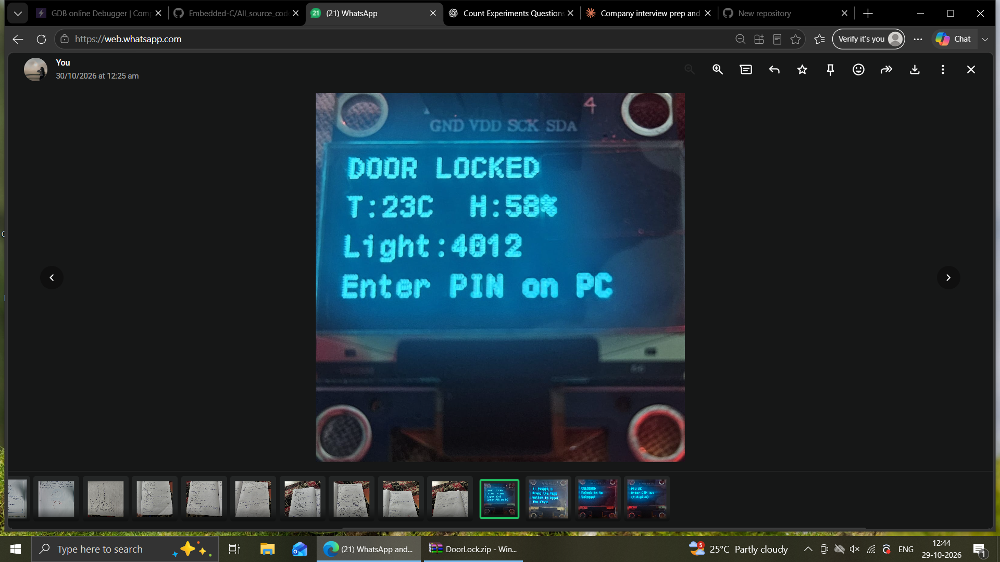
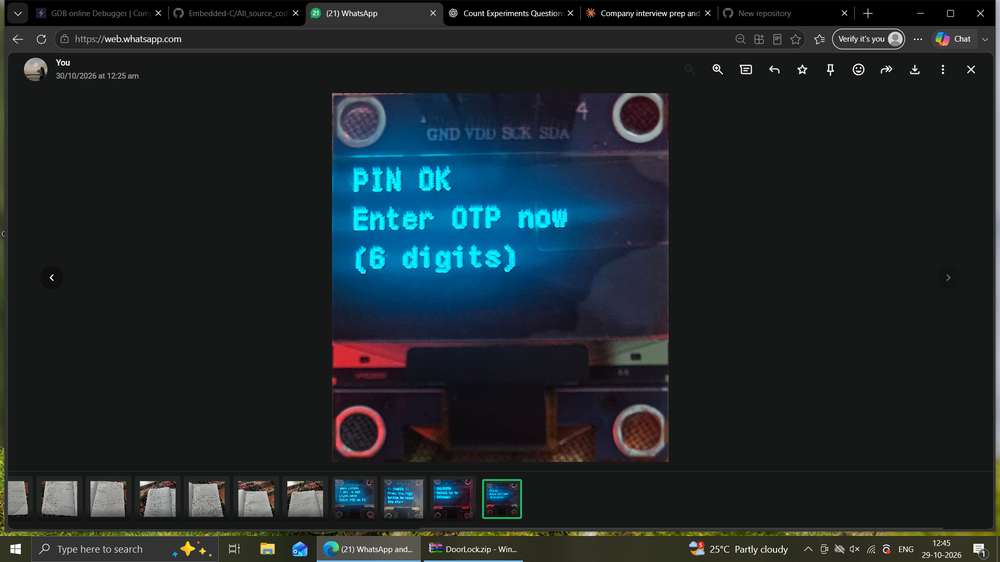
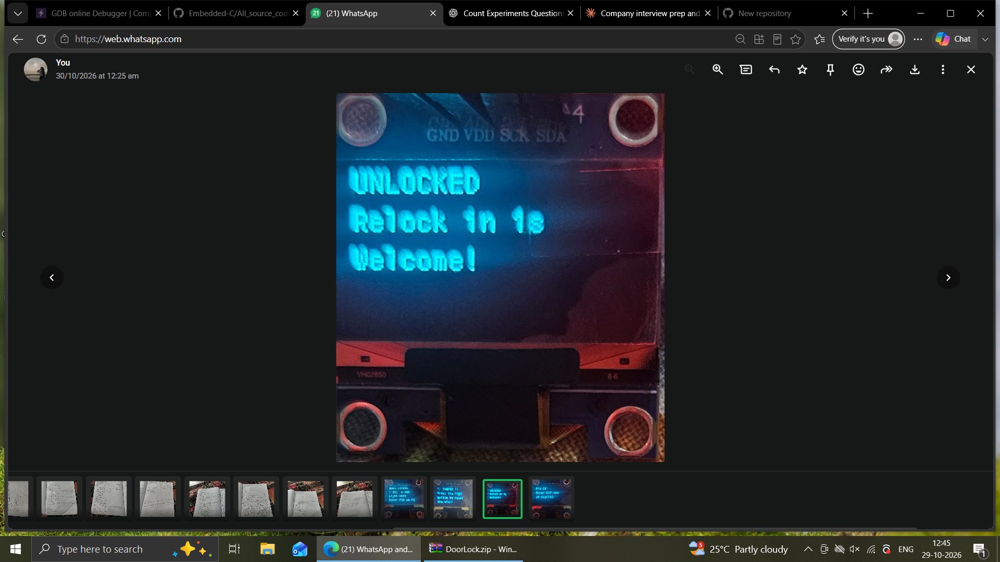
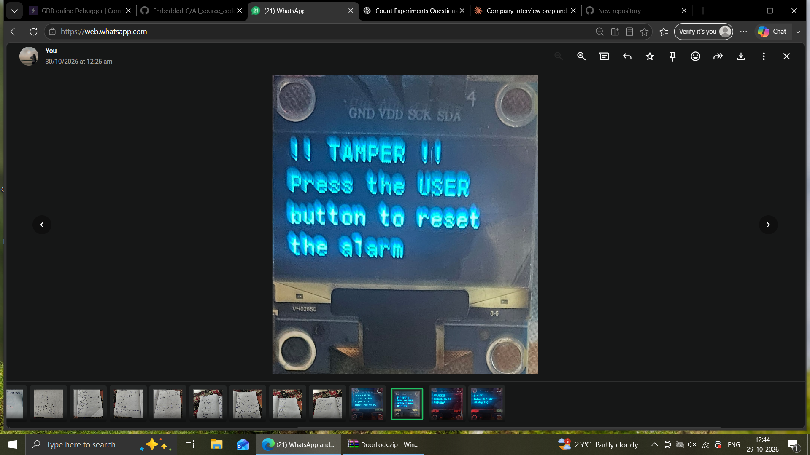

# STM32 Two-Factor Smart Door Lock

A bare-metal C door lock for an STM32 Nucleo board. The door opens only after **two factors**: a PIN and a time-based one-time password (TOTP) from an authenticator app. It also logs every event to on-chip flash and raises a tamper alarm when the light level around the lock changes suddenly.

| Locked, waiting for PIN | PIN accepted, OTP needed |
| --- | --- |
|  |  |

| Unlocked | Tamper alarm |
| --- | --- |
|  |  |

## Features

- **Two-factor unlock:** PIN first, then a 6-digit TOTP (RFC 6238: HMAC-SHA1, 30 s step). The code is generated by an authenticator app on your phone (Google Authenticator or similar), so nothing is sent over SMS or the internet.
- **No external crypto library:** SHA-1, HMAC-SHA1, Base32 and HOTP/TOTP are written in plain C in `Core/Src/totp.c`.
- **PIN never stored in plain text:** a 4-byte random salt plus SHA-1 of salt + PIN is kept in flash. PIN comparison is constant-time.
- **Clock drift tolerance and replay protection:** codes from the previous, current and next 30 s window are accepted, and each code works only once.
- **Brute-force lockout:** after 3 wrong attempts the lock stays locked for 30 s, doubling on each repeat up to 480 s.
- **Tamper detection:** an LDR on the ADC watches the light level. A change of more than 1000 counts (out of 4095) while locked raises an alarm and disables input until the blue USER button is pressed.
- **Event log in on-chip flash:** 8 bytes per entry (timestamp, event, temperature, humidity, light). Type `LOG` at the PIN prompt to dump it over UART.
- **First-boot provisioning:** choose a PIN and enter or auto-generate a Base32 secret over the serial terminal. Hold the USER button at reset to re-provision.
- **Robust OLED:** an I²C bus-recovery routine (9 clock pulses plus a STOP condition) frees the bus if the display locks it up.

## Hardware

| Part | Pin | Interface | Purpose |
| --- | --- | --- | --- |
| STM32 Nucleo (project configured for STM32F401RE, Cortex-M4) | | | Main controller |
| SSD1306 128x64 OLED | PB8 (SCL), PB9 (SDA) | I²C1, 100 kHz | Status display |
| DHT11 | PA9 | Single-wire, bit-banged | Temperature and humidity |
| LDR in a voltage divider | PA0 (ADC1_IN0) | 12-bit ADC | Light level and tamper detection |
| On-board green LED (LD2) | PA5 | GPIO output | Stands in for the lock actuator (a real door needs a relay or transistor with a flyback diode) |
| On-board blue USER button | PC13 | GPIO input | Clears the tamper alarm, forces setup mode |
| ST-LINK virtual COM port | PA2 (TX), PA3 (RX) | USART2, 115200 8N1 | PIN and OTP entry, logs, setup |

No external memory chip and no keypad are used: the PIN hash, OTP secret and event log are all stored in the microcontroller's **internal flash**, and the PIN and OTP are typed in a serial terminal on a PC.

## How it works

1. At boot the firmware calibrates the light baseline and loads the configuration from flash. If none exists (or the USER button is held), it enters setup mode.
2. There is no RTC, so you type the current time as `T<unix-seconds>` (for example `T1760000000`) over the terminal. The firmware then counts time with the SysTick timer.
3. The OLED shows `DOOR LOCKED`, temperature, humidity and the light value. Enter the PIN in the terminal (digits are masked).
4. If the PIN is correct, the OLED asks for the OTP. Open the authenticator app on your phone and enter the current 6-digit code within 45 seconds.
5. If the OTP is valid, the lock output turns on for 5 seconds, then relocks.
6. Every attempt, unlock, lockout and tamper event is written to the flash log.

## Flash layout (STM32F401RE, 512 KB)

| Sector | Address | Use |
| --- | --- | --- |
| 0 to 5 | 0x08000000 | Program code |
| 6 | 0x08040000 | Configuration: magic, secret, salt, PIN hash |
| 7 | 0x08060000 | Event log, 8 bytes per entry (16384 entries). Sector is erased when full |

## Build and run

1. Open the project in STM32CubeIDE (File, Open Projects from File System).
2. Build and flash to the Nucleo board.
3. Open a serial terminal on the ST-LINK COM port at 115200 baud, 8N1.
4. Follow the prompts: set the time, choose a PIN, and add the printed Base32 secret to your authenticator app (time-based, SHA-1, 6 digits, 30 s).

## Code structure

| File | Role |
| --- | --- |
| `Core/Src/main.c` | CubeMX-generated setup (clock, ADC1, I²C1, USART2) and the main loop calling `App_Loop()` |
| `Core/Src/lock_app.c` | Application: state machine, PIN and OTP checks, flash log, DHT11 driver, tamper logic |
| `Core/Src/totp.c` | SHA-1, HMAC-SHA1, Base32, HOTP/TOTP, constant-time compare (no HAL dependency) |
| `Core/Src/ssd1306.c` | OLED driver |

## Known limitations and next steps

- PIN and OTP are typed on a PC terminal. A keypad would make it a standalone lock.
- A single salted SHA-1 is a weak way to protect a short PIN if someone dumps the flash. Next step: a slow key-derivation function, plus enabling flash read-out protection.
- The TOTP secret is stored unencrypted in flash.
- Replay protection state is kept in RAM, so it resets on reboot.
- The clock must be set at every boot; adding the on-chip RTC with a backup battery would fix this.
- The firmware is polling-based with blocking delays; moving to an RTOS or interrupt-driven design would improve responsiveness.

## Security note

No PIN or secret is hard-coded in the source. They are created during setup and stored only in the device's flash.
